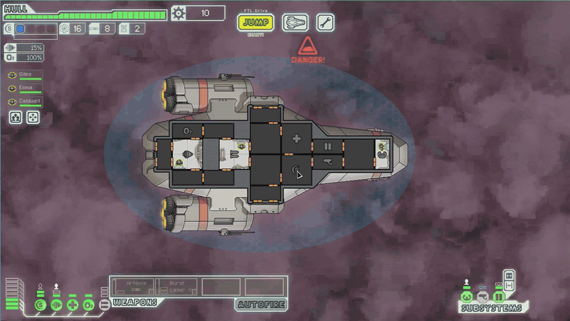

# ftlpad

  
  
  

  <a href="#install">Install</a> &middot;
  <a href="docs/CONTROLS.md">Docs</a> &middot;
  <a href="https://github.com/mxmgorin/ftlpad/issues">Issues</a>

Controller support for [FTL: Faster Than Light](https://subsetgames.com/ftl.html) on Linux: play it with a gamepad, without changing the game files.

## Features

- **Zones**: the D-pad and sticks jump between rooms, doors, event choices, beacons and buttons
- **Door mode**: hold L2 to jump between doors, tap it to toggle a room's doors
- **Wheels** for weapons, crew, systems, ship orders and abilities, in the game's own art
- **Tap and hold** actions on every button
- **Fast forward** while a button is held
- **Help**: hold Start for the controls table
- **Editable layout** in `ftlpad.ini`, re-read while the game runs
- **Free cursor mode**: the D-pad and sticks move the game's cursor
- **Larger text** in event boxes and tooltips on screens smaller than 1280x720
- **Build check**: on an FTL build other than Steam 1.6.13 or GOG 1.6.12, ftlpad stays inactive and the game runs without it

## Install

Requires the native Linux build of FTL: 1.6.13 from Steam or 1.6.12 from GOG. The Windows and macOS builds are not supported. The steps below are for Steam.

1. Download [`ftlpad-linux-x86_64.tar.gz`](https://github.com/mxmgorin/ftlpad/releases/latest/download/ftlpad-linux-x86_64.tar.gz) from the [latest release](https://github.com/mxmgorin/ftlpad/releases/latest) and unpack it anywhere, e.g. `~/ftlpad/`.
2. In Steam, open FTL's **Properties > General > Launch Options** and enter:

       ~/ftlpad/ftlpad-linux-x86_64/ftlpad.sh %command%

3. In **Properties > Controller**, set Steam Input to **Disabled** for FTL.
4. In **Properties > Compatibility**, leave **Force the use of a specific Steam Play compatibility tool** off.

See **[Linux](docs/LINUX.md)** for GOG, running without Steam and troubleshooting.

## Controls

Hold **Start** in the game for the controls table. See **[Controls](docs/CONTROLS.md)**.

## Configuration

Settings and bindings are in `ftlpad.ini`. See **[Configuration](docs/CONFIGURATION.md)**.

## Building

See **[Building](docs/BUILDING.md)**.

## How to help

If you find the project useful, here is how you can help:

- **Tell other people about it.** Sharing the project helps it reach more users.
- **Report bugs and request features** in [Issues](https://github.com/mxmgorin/ftlpad/issues). Feedback is welcome.
- **Star the repo.** It helps the project get noticed and keeps me motivated.
- **[Buy me a coffee](https://ko-fi.com/mxmgorin)** on Ko-fi.

## Credits

- [FTL: Faster Than Light](https://subsetgames.com/ftl.html) by Subset Games

## License

Copyright (C) 2026 Maxim Gorin. ftlpad is free software under the
[GNU General Public License v3.0 or later](LICENSE), with the additional terms in
[NOTICE](NOTICE).

ftlpad is an unofficial mod, not affiliated with or endorsed by Subset Games.
FTL: Faster Than Light is a trademark of Subset Games.
