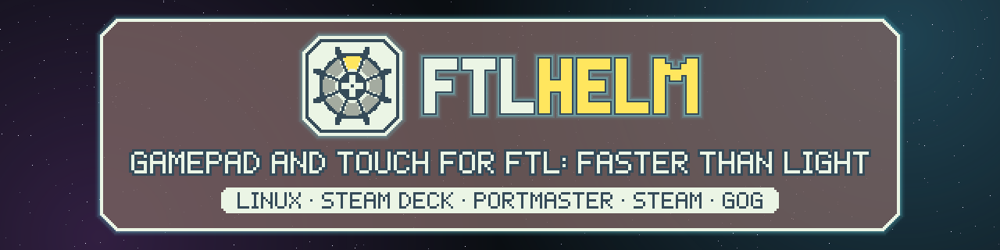
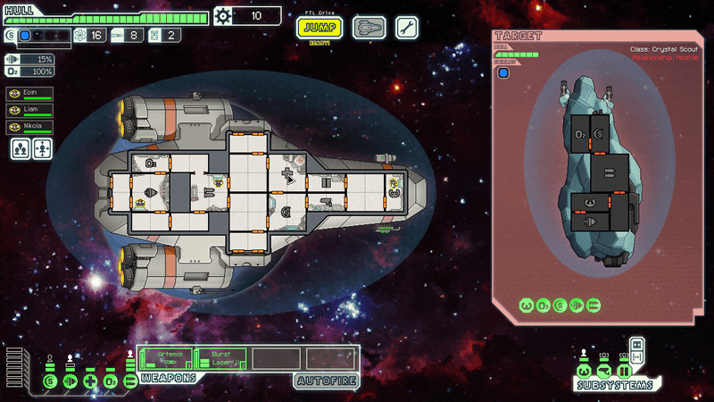
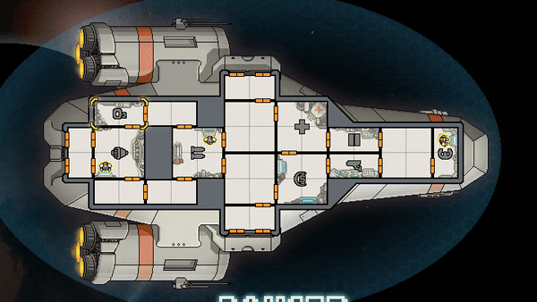
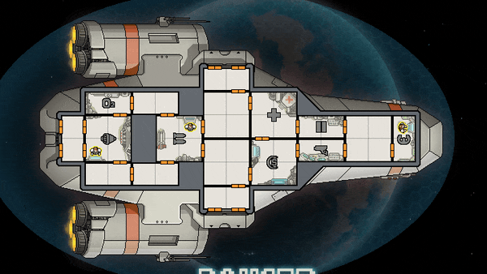
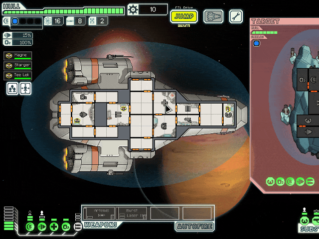
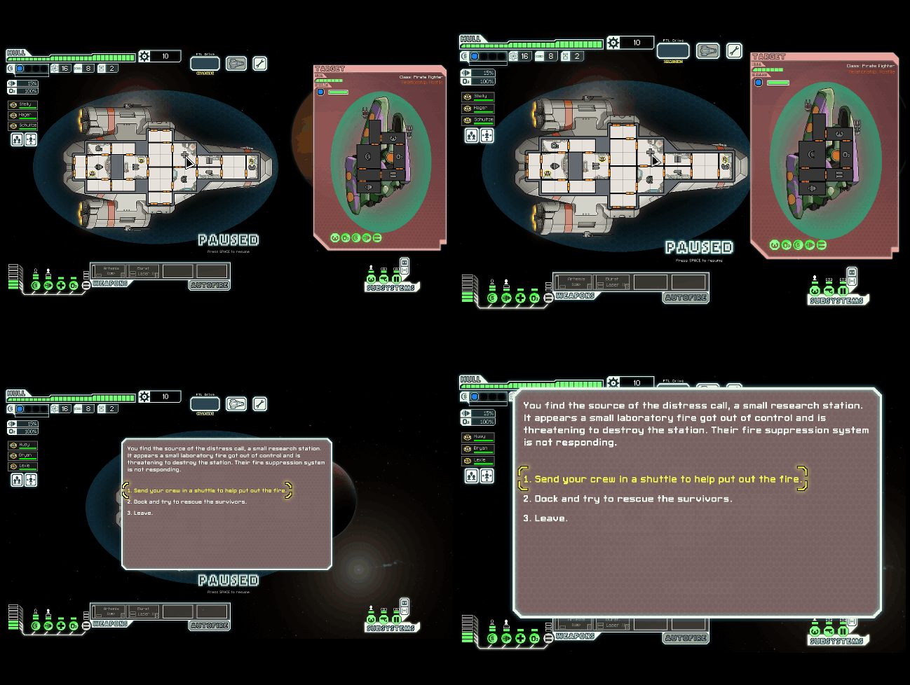
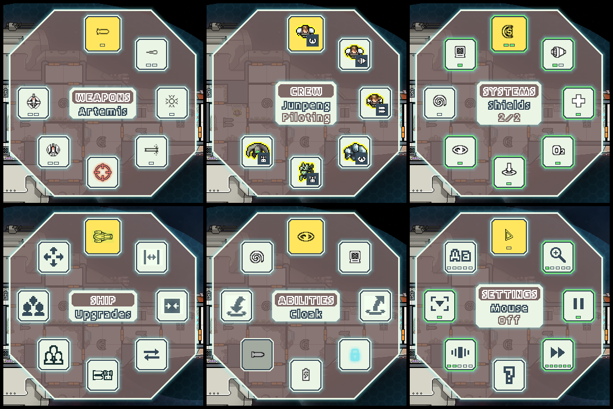

  

  
  
  

  <a href="#install">Install</a> &middot;
  <a href="#docs">Docs</a> &middot;
  <a href="https://github.com/mxmgorin/ftlhelm/issues">Issues</a>

ftlhelm is a gamepad and touchscreen layer for [FTL: Faster Than Light](https://subsetgames.com/ftl.html) on Linux, including the Steam Deck, written in Rust. It loads with the game and maps pad and touch input to the game's own mouse and keyboard controls; the game files remain untouched.

 The D-pad, the weapons wheel, a volley and a jump, all on a gamepad

## Features

- **Zones**: the D-pad and sticks jump between rooms, doors, event choices, beacons and buttons
- **Wheels** for weapons, crew, systems, ship orders and abilities, in the game's own art
- **Small screens**, on by default below 1280x720:
  - **Zoom**: the ship view magnified around the cursor; the map, ship and store screens enlarged to fit
  - **Frame filter**: smoother, sharper picture
  - **Text size**: event boxes and tooltips 1 to 2 times the game's own
  - **Pointer size**: the mouse arrow drawn up to twice as large
  - **HUD shift**: on screens narrower than 16:9, the HUD's edge panels move toward the middle as far as the player ship leaves room
- **iPad icons**: the map's beacons and the crew station buttons in the larger art of FTL's iPad edition, each on its own switch
- **Fast forward** while a button is held
- **Mouse mode**: the D-pad and sticks move the game's cursor freely
- **Touch**: the touchscreen works as the mouse
  - **Tap** to click, **hold** to right-click, **drag** to select
  - **Swipe** up or down on a system icon or weapon box to set its power
  - **Two-finger tap** or the on-screen button to pause
  - **Near misses** land on the closest button, room or icon
- **Remappable**: tap and hold actions on every button, wheels and their plates in `ftlhelm.ini`, re-read while the game runs

<table align="center">
  <tr>
    <td align="center"> <b>Zones</b>: the D-pad steps through rooms, event choices, beacons and store items</td>
    <td align="center"> <b>Touch</b>: tap to select and send crew, swipe to set power, hold to right-click, the pause button</td>
  </tr>
</table>

 <b>Zoom</b> on a 640x480 screen: the settings wheel sets the level, the view follows the cursor, the beacon map enlarged to fit

 <b>Small screens</b> at 640x480: without ftlhelm on the left, with it on the right

## Controls

| Button | Tap | Hold |
| --- | --- | --- |
| D-pad, sticks | the next zone that way | |
| A | click; select the room's crew | drag |
| B | cancel, back | abilities wheel |
| X | arm the next weapon | weapons wheel |
| Y | next crew member | crew wheel |
| L1 | previous tab | systems wheel |
| R1 | next tab | ship orders wheel |
| L2 | toggle the room's doors | doors become the zones |
| R2 | beacon map | fast forward |
| L3, R3 | mouse mode on, off | |
| Start | pause | zoom out while zoomed |
| Select | settings wheel | game menu |

 <b>Wheels</b>: weapons, crew, systems, ship orders, abilities, settings and view

## Install

Requires the native Linux build of FTL: 1.6.13 from Steam or 1.6.12 from GOG, and glibc 2.35 or later. The Windows and macOS builds are not supported. On another Linux build, ftlhelm stays inactive and the game runs without it.

Download [`ftlhelm-linux-x86_64.tar.gz`](https://github.com/mxmgorin/ftlhelm/releases/latest/download/ftlhelm-linux-x86_64.tar.gz) from the [latest release](https://github.com/mxmgorin/ftlhelm/releases/latest) and unpack it anywhere, e.g. `~/ftlhelm/`. `ftlhelm.sh` expects the other files where the archive puts them.

### Steam

1. In FTL's **Properties > General > Launch Options**, enter:

       ~/ftlhelm/ftlhelm-linux-x86_64/ftlhelm.sh %command%

2. In **Properties > Controller**, set Steam Input to **Disabled** for FTL.
3. In **Properties > Compatibility**, leave **Force the use of a specific Steam Play compatibility tool** off.

### Steam Deck

As for Steam, except step 2: leave Steam Input on, and in FTL's **Controller Settings** open the current layout and apply **Templates > Gamepad**.

For touch in Game Mode, open FTL's controller layout (**Controller Settings > Edit Layout > Action Sets**), choose the gear of the action set, **Add Always-On command**, and set it to the System command **Touchscreen Native Support**. Desktop Mode needs no setting.

### GOG

    ~/ftlhelm/ftlhelm-linux-x86_64/ftlhelm.sh "/path/to/the GOG install/start.sh"

### Without Steam

A Steam copy runs from its own directory:

    cd "/path/to/FTL Faster Than Light"
    ~/ftlhelm/ftlhelm-linux-x86_64/ftlhelm.sh ./FTL

### PortMaster

On aarch64 handhelds, ftlhelm comes with the [FTL port for PortMaster](https://portmaster.games/detail.html?name=ftl).

If ftlhelm does not start, see **[Troubleshooting](docs/TROUBLESHOOTING.md)**.

## Docs

- **[Controls](docs/CONTROLS.md)**: zones, doors, mouse mode, wheels, zoom, text size, touch
- **[Configuration](docs/CONFIGURATION.md)**: settings, bindings, wheels, environment variables
- **[Troubleshooting](docs/TROUBLESHOOTING.md)**: the log and what its lines mean
- **[Building](docs/BUILDING.md)**: build commands, CI, test channel

## How to help

If you find the project useful, here is how you can help:

- **Tell other people about it.** Sharing the project helps it reach more users.
- **Report bugs and request features** in [Issues](https://github.com/mxmgorin/ftlhelm/issues). Feedback is welcome. Attach `ftlhelm.log` from the ftlhelm folder to a bug report.
- **Star the repo.** It helps the project get noticed and keeps me motivated.
- **[Buy me a coffee](https://ko-fi.com/mxmgorin)** on Ko-fi.

## License

Copyright (C) 2026 Maxim Gorin. ftlhelm is free software under the
[GNU General Public License v3.0 or later](LICENSE), with the additional terms in
[NOTICE](NOTICE). The name, logo and icon: [TRADEMARKS.md](TRADEMARKS.md).

ftlhelm is an unofficial mod, not affiliated with or endorsed by Subset Games.
FTL: Faster Than Light is a trademark of Subset Games.
