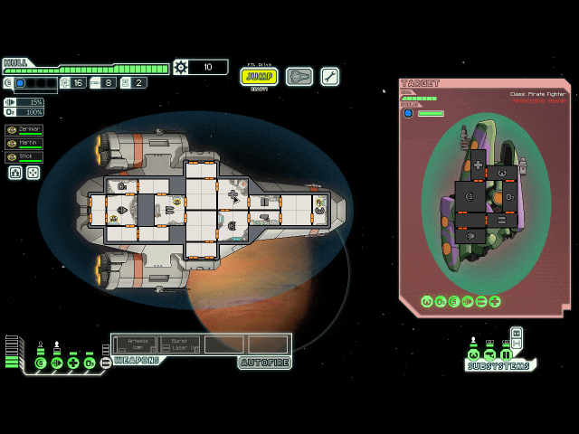

# ftlhelm

  
  
  

  <a href="#install">Install</a> &middot;
  <a href="#docs">Docs</a> &middot;
  <a href="https://github.com/mxmgorin/ftlhelm/issues">Issues</a>

Controller support for [FTL: Faster Than Light](https://subsetgames.com/ftl.html) on Linux: play it with a gamepad, without changing the game files.

## Features

- **Zones**: the D-pad and sticks jump between rooms, doors, event choices, beacons and buttons
- **Wheels** for weapons, crew, systems, ship orders and abilities, in the game's own art
- **Small screens**, on by default below 1280x720:
  - **Zoom**: the ship view magnified around the cursor; the map, ship and store screens enlarged to fit
  - **Text size**: event boxes and tooltips 1 to 2 times the game's own
- **Fast forward** while a button is held
- **Mouse mode**: the D-pad and sticks move the game's cursor freely
- **Remappable**: tap and hold actions on every button, wheels and their plates in `ftlhelm.ini`, re-read while the game runs

## Controls

| Button | Tap | Hold |
| --- | --- | --- |
| D-pad, sticks | the next zone that way | |
| A | click | drag |
| B | cancel, back | abilities wheel |
| X | arm the next weapon | weapons wheel |
| Y | next crew member | crew wheel |
| L1 | previous tab | systems wheel |
| R1 | next tab | ship orders wheel |
| L2 | toggle the room's doors | doors become the zones |
| R2 | beacon map | fast forward |
| L3, R3 | mouse mode on, off | |
| Start | pause | whole frame while zoomed |
| Select | settings wheel | game menu |

Tap **Select** in the game for the settings wheel: mouse mode, zoom, text size and the controls table.

## Install

Requires the native Linux build of FTL: 1.6.13 from Steam or 1.6.12 from GOG, and glibc 2.35 or later. The Windows and macOS builds are not supported. On another Linux build, ftlhelm stays inactive and the game runs without it.

Download [`ftlhelm-linux-x86_64.tar.gz`](https://github.com/mxmgorin/ftlhelm/releases/latest/download/ftlhelm-linux-x86_64.tar.gz) from the [latest release](https://github.com/mxmgorin/ftlhelm/releases/latest) and unpack it anywhere, e.g. `~/ftlhelm/`. `ftlhelm.sh` expects the other files next to it.

### Steam

1. In FTL's **Properties > General > Launch Options**, enter:

       ~/ftlhelm/ftlhelm-linux-x86_64/ftlhelm.sh %command%

2. In **Properties > Controller**, set Steam Input to **Disabled** for FTL.
3. In **Properties > Compatibility**, leave **Force the use of a specific Steam Play compatibility tool** off.

### GOG

    ~/ftlhelm/ftlhelm-linux-x86_64/ftlhelm.sh "/path/to/the GOG install/start.sh"

### Without Steam

A Steam copy runs from its own directory:

    cd "/path/to/FTL Faster Than Light"
    ~/ftlhelm/ftlhelm-linux-x86_64/ftlhelm.sh ./FTL

If ftlhelm does not start, see **[Troubleshooting](docs/TROUBLESHOOTING.md)**.

## Docs

- **[Controls](docs/CONTROLS.md)**: zones, doors, mouse mode, wheels, zoom, text size
- **[Configuration](docs/CONFIGURATION.md)**: settings, bindings, wheels, environment variables
- **[Troubleshooting](docs/TROUBLESHOOTING.md)**: the log and what its lines mean
- **[Building](docs/BUILDING.md)**: build commands, CI, test channel

## How to help

If you find the project useful, here is how you can help:

- **Tell other people about it.** Sharing the project helps it reach more users.
- **Report bugs and request features** in [Issues](https://github.com/mxmgorin/ftlhelm/issues). Feedback is welcome.
- **Star the repo.** It helps the project get noticed and keeps me motivated.
- **[Buy me a coffee](https://ko-fi.com/mxmgorin)** on Ko-fi.

## License

Copyright (C) 2026 Maxim Gorin. ftlhelm is free software under the
[GNU General Public License v3.0 or later](LICENSE), with the additional terms in
[NOTICE](NOTICE).

ftlhelm is an unofficial mod, not affiliated with or endorsed by Subset Games.
FTL: Faster Than Light is a trademark of Subset Games.
