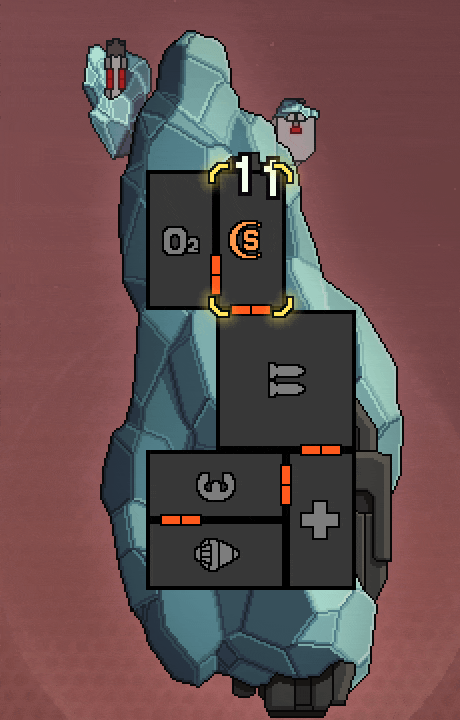

  

  
  
  

  <a href="#install">Install</a> &middot;
  <a href="#docs">Docs</a> &middot;
  <a href="https://github.com/mxmgorin/ftlhelm/issues">Issues</a>

**FTLHELM** is a gamepad and touchscreen layer for [FTL: Faster Than Light](https://subsetgames.com/ftl.html) on Linux, including the Steam Deck, written in Rust. It loads with the game and maps pad and touch input to the game's own mouse and keyboard controls; the game files remain untouched.

 The D-pad, a volley, the weapons wheel, an aimed beam and a jump, all on a gamepad

## Features

- **Zones**: the D-pad and sticks jump between rooms, doors, weapon and drone boxes, event choices, beacons, store items and menu buttons
- **Weapons**:
  - **Arm** the next powered weapon with one press, aim with another
  - **Volleys**: fire all weapons, or those selected on the weapons wheel, at one room
  - **Beams**: lay beams through as many rooms as possible, then turn, slide or move them with the pad
  - **Reorder**: move weapons and drones one slot at a time
- **Crew**: select a room's crew one at a time, then all, with repeated presses; step to the next crew member with another button; add or remove crew members with the crew wheel
- **Doors**: open or close all doors in a room at once, or control individual doors
- **Wheels** for weapons, crew, systems, ship orders and abilities, using the game's own artwork
- **Overlay**:
  - **Focus brackets** around the item under the cursor
  - **Crew markers** over selected crew members
  - **Mode badge** where the game writes PAUSED, showing the aimed weapon, selected crew and active modes
- **Autopause**: the game pauses while a wheel is open, while aiming, or both
- **Fast forward**: speed up the game while a button is held
- **Mouse mode**: move the game's cursor freely with the D-pad and sticks
- **In-game help**: button, wheel, weapon, crew and door controls; shown on first run
- **Small screens**, enabled by default below 1280x720:
  - **Zoom**: magnify the ship view around the cursor; enlarge the map, ship and store screens to fit
  - **Frame filter**: smoother, sharper picture
  - **Text size**: scale event boxes and tooltips up to 2x the game's original size
  - **Pointer size**: keep the mouse cursor at the game's own size, or set it from half to twice that
  - **HUD shift**: on screens narrower than 16:9, move the HUD's edge panels toward the middle, as far as the ship allows
- **iPad icons**: use the larger icons from FTL's iPad edition for map beacons and crew station buttons, each controlled by its own switch
- **Touch**: use the touchscreen as a mouse
  - **Tap** to click, **hold** to right-click, **drag** to select
  - **Swipe** up or down on a system icon or weapon box to adjust its power
  - **Two-finger tap** or the on-screen button to pause
  - **Pinch** to zoom and move the ship view
  - **Near misses** land on the closest button, room or icon
- **In-game settings**: adjust zoom, text size, pointer size, autopause, fast-forward speed, overlay, frame filter, iPad artwork, button swap, touch and rumble from the settings wheel
- **Any pad**: the last controller used takes control; the game pauses if it disconnects; A/B and X/Y can be swapped for controllers with different button layouts; rumble support
- **Remappable**: configure tap and hold actions for every button, and the wheels and their plates, in `ftlhelm.ini`; changes are reloaded while the game is running

<table align="center">
  <tr>
    <td align="center"> <b>Zones</b>: the D-pad steps through rooms, event choices, beacons and store items</td>
    <td align="center"> <b>Touch</b>: tap to select and send crew, swipe to set power, hold to right-click, the pause button</td>
  </tr>
</table>

<table align="center">
  <tr>
    <td align="center" valign="top"> <b>Zoom</b> on a 640x480 screen: the settings wheel sets the level, the view follows the cursor, the beacon map enlarged to fit</td>
    <td align="center" valign="top"> <b>Beams</b>: lay the line, turn it, slide it, move it with A held</td>
  </tr>
</table>

 <b>Small screens</b> at 640x480: without FTLHELM on the left, with it on the right

## Controls

| Button | Tap | Hold |
| --- | --- | --- |
| D-pad, sticks | the next zone that way | |
| A | click; select the room's crew | drag |
| B | cancel, back; pause with nothing to cancel | abilities wheel |
| X | arm the next weapon | weapons wheel |
| Y | next crew member | crew wheel |
| L1 | previous tab | systems wheel |
| R1 | next tab | ship orders wheel |
| L2 | toggle the room's doors | doors become the zones |
| R2 | beacon map | fast forward |
| L3, R3 | the other ship | |
| Start | pause | zoom out while zoomed |
| Select | settings wheel | |

 <b>Wheels</b>: weapons, crew, systems, ship orders, abilities, settings, view and controls

## Install

Requires the native Linux build of FTL: 1.6.13 from Steam or 1.6.12 from GOG, and glibc 2.35 or later. The Windows and macOS builds are not supported. On another Linux build, FTLHELM stays inactive and the game runs without it.

Download [`ftlhelm-linux-x86_64.tar.gz`](https://github.com/mxmgorin/ftlhelm/releases/latest/download/ftlhelm-linux-x86_64.tar.gz) from the [latest release](https://github.com/mxmgorin/ftlhelm/releases/latest) and unpack it anywhere, e.g. `~/ftlhelm/`. `ftlhelm.sh` expects the other files where the archive puts them.

### Steam

1. In FTL's **Properties > General > Launch Options**, enter:

       ~/ftlhelm/ftlhelm-linux-x86_64/ftlhelm.sh %command%

2. In **Properties > Controller**, set Steam Input to **Disabled** for FTL.
3. In **Properties > Compatibility**, leave **Force the use of a specific Steam Play compatibility tool** off.

### Steam Deck

As for Steam, except step 2: leave Steam Input on, and in FTL's **Controller Settings** open the current layout and apply **Templates > Gamepad**.

For touch in Game Mode, open FTL's controller layout (**Controller Settings > Edit Layout > Action Sets**), choose the gear of the action set, **Add Always-On command**, and set it to the System command **Touchscreen Native Support**. Desktop Mode needs no setting.

### GOG

    ~/ftlhelm/ftlhelm-linux-x86_64/ftlhelm.sh "/path/to/the GOG install/start.sh"

### Without Steam

A Steam copy runs from its own directory:

    cd "/path/to/FTL Faster Than Light"
    ~/ftlhelm/ftlhelm-linux-x86_64/ftlhelm.sh ./FTL

### PortMaster

On aarch64 handhelds, FTLHELM comes with the [FTL port for PortMaster](https://portmaster.games/detail.html?name=ftl).

If FTLHELM does not start, see **[Troubleshooting](docs/TROUBLESHOOTING.md)**.

## Docs

- **[Controls](docs/CONTROLS.md)**: zones, doors, weapons, wheels, touch, zoom
- **[Configuration](docs/CONFIGURATION.md)**: settings, bindings, wheels, environment variables
- **[Troubleshooting](docs/TROUBLESHOOTING.md)**: the log and what its lines mean
- **[Building](docs/BUILDING.md)**: build commands, CI, test channel

## How to help

If you find the project useful, here is how you can help:

- **Tell other people about it.** Sharing the project helps it reach more users.
- **Report bugs and request features** in [Issues](https://github.com/mxmgorin/ftlhelm/issues). Feedback is welcome. Attach `ftlhelm.log` from the folder of `ftlhelm.sh` to a bug report.
- **Star the repo.** It helps the project get noticed and keeps me motivated.
- **[Buy me a coffee](https://ko-fi.com/mxmgorin)** on Ko-fi.

## License

Copyright (C) 2026 Maxim Gorin. FTLHELM is free software under the
[GNU General Public License v3.0 or later](LICENSE), with the additional terms in
[NOTICE](NOTICE). The name, logo and icon: [TRADEMARKS.md](TRADEMARKS.md).

FTLHELM is an unofficial mod, not affiliated with or endorsed by Subset Games.
FTL: Faster Than Light is a trademark of Subset Games.
